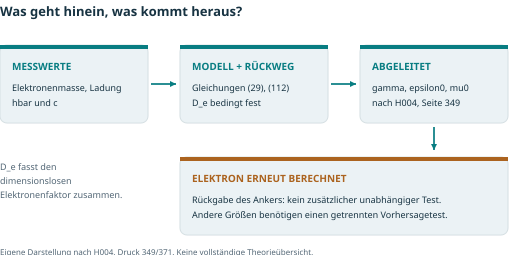
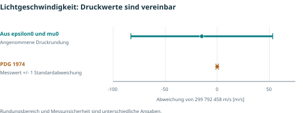
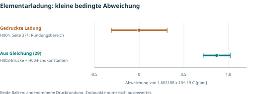

# Grafischer Einstieg: Etappen 39 und 40

Stand 18.10.2026. Eigene Darstellungen aus dem lokalen Quellen- und
Rechenaudit, keine Abbildungen aus den Quellbüchern.

Die [zweiseitige PDF](../../output/pdf/Heim_Audit_Ueberblick_2026-10-18.pdf)
bündelt die Grafiken mit Einordnung und Quellen. Sie ist eine datierte
Zusammenfassung des geprüften Ausschnitts, kein Abschlussbericht zur
gesamten Theorie. Die Markdown-Berichte bleiben die ausführliche Dokumentation:
[F_S-Provenienz](../../06_docs/FS_PROVENANCE_2026-10-18.md) und
[Konstantenkorrektur](../../06_docs/CONSTANTS_ANCHOR_2026-10-18.md).

## Abhängigkeiten



D_e bezeichnet den bedingt festgehaltenen dimensionslosen Elektronenfaktor.
Eine erneute empirische Bestimmung von F_S kann diesen Faktor ändern.

## Lichtgeschwindigkeit



Der obere Balken zeigt angenommene Druckrundung der Konstanten; der untere
eine historische Messunsicherheit von einer Standardabweichung.
Diese Größen dürfen nicht als gleichartige Konfidenzintervalle gelesen werden.

## Elementarladung



Beide Balken zeigen hier angenommene Druckrundung. Die Abweichung von rund
0,87 ppm ist kleiner als die damalige Messunsicherheit von rund2,9 ppm.
Die H003/H004-Editionsbrücke ist eine Voraussetzung des Vergleichs;
Ursache der Abweichung und historische ungerundete Eingaben bleiben offen.

## Reproduktion

Python >=3.10 und ReportLab (`python -m pip install reportlab`). Die
Schriften Vera/VeraBd stammen aus der ReportLab-Installation und werden
in der PDF eingebettet. Die SVGs enthalten Text mit Schrift-Fallback.

```powershell
py -3.13 -B scripts/audit_constants_anchor.py --check
py -3.13 -B scripts/build_audit_overview.py
```

Der Generator liest `05_analysis/constants_anchor_results.json`, schreibt
die drei SVGs und die PDF, verändert aber keine wissenschaftlichen Inputs.
Rationale c-Kontrolle und hochpräzise Ladungsrechnung bleiben im separaten
Diagnosecode; die Grafiken stellen nur dessen Werte dar.
Die Ausgabe ist bei unveränderten Daten und gleicher ReportLab-Version
deterministisch. Beide PDF-Seiten wurden nach Poppler-Rendering visuell geprüft.
Nur die ausdrücklich freigegebene eigene PDF ist von der allgemeinen
PDF-Gitignore-Regel ausgenommen; Quellbücher bleiben lokale Dateien.
